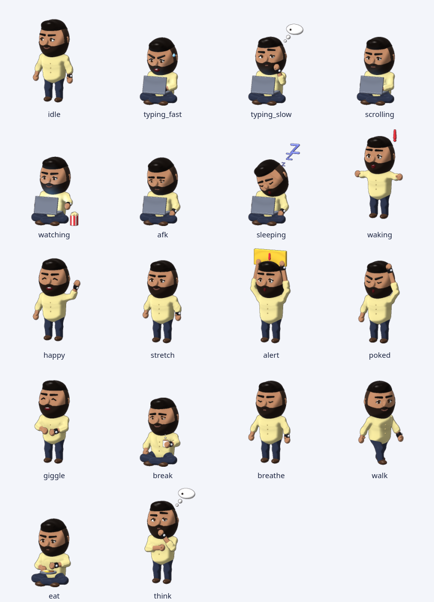

# Saarthi: your animated desktop companion



Saarthi lives on your screen and reacts to what you're doing: type fast and it sweats, pause to think and
it ponders, watch a tutorial and it grabs popcorn, walk away and it falls asleep. It keeps your reminders
and notes, takes breaks and lunch with you, breathes with you and tells you the traffic home.

## Install (Linux)

Open a terminal and run:

```bash
curl -fsSL https://raw.githubusercontent.com/Ashish04Kumar/saarthiDesk-releases/main/install.sh | bash
```

That's it: Saarthi appears on your screen and in your app menu. No Python, no admin rights.

Start it with your computer:

```bash
curl -fsSL https://raw.githubusercontent.com/Ashish04Kumar/saarthiDesk-releases/main/install.sh | bash -s -- --autostart
```

**Works on:** Ubuntu 22.04+, Linux Mint 21+, Pop!_OS 22.04+, Debian 12+, Fedora 35+, Arch, openSUSE
Tumbleweed (64-bit Intel/AMD). Windows and macOS builds are coming.

## After installing

| | |
|---|---|
| Start | App menu → **Saarthi**, or `saarthi` in a terminal |
| Stop | Right-click the character → **Quit**, or `saarthi --quit` |
| Use | **Double-click**: reminders & notes · **Right-click**: menu · **Drag**: move it |
| Update | Run the install command again |
| Uninstall | `curl -fsSL https://raw.githubusercontent.com/Ashish04Kumar/saarthiDesk-releases/main/install.sh \| bash -s -- --uninstall` |

**Typing detection on Wayland** (Ubuntu's default): run `sudo usermod -aG input $USER` once and log out and
back in. Saarthi only counts how fast you type, never what you type. On X11 nothing is needed.

**Window doesn't appear?** Install the few system libraries the installer mentions, e.g. on Ubuntu:
`sudo apt install -y libxcb-cursor0 libxkbcommon-x11-0 libegl1`

Your notes, reminders and settings live in `~/.config/saarthi` and are kept when you update or uninstall.

## Developer

**Ashish Kumar** · [ashishishere11@gmail.com](mailto:ashishishere11@gmail.com) · [@Ashish04Kumar](https://github.com/Ashish04Kumar)
